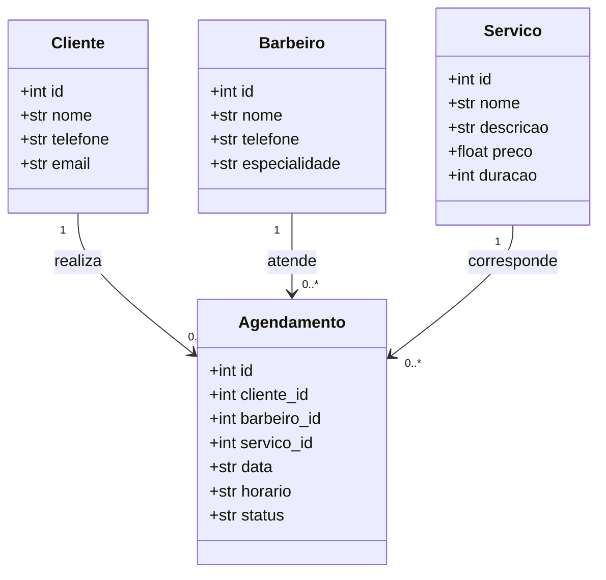

# Diagrama UML — Barbearia Elite

## Relacionamentos
- Um cliente pode realizar vários agendamentos.
- Um barbeiro pode atender vários agendamentos.
- Um serviço pode aparecer em vários agendamentos.
- Cada agendamento pertence a um cliente, um barbeiro e um serviço.
